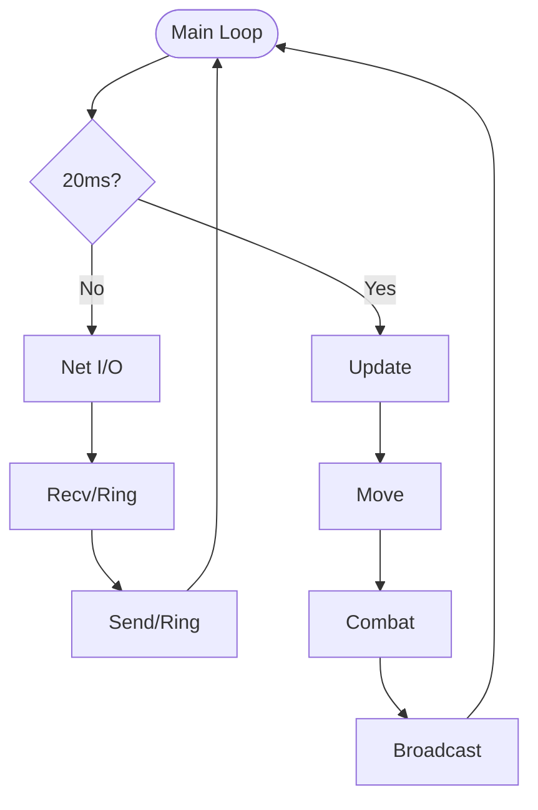

# 실시간 다수 연결 서버 — TCPFighter

### 연결이 오가는 구조를 직접 만들고, 어디서 새고 막히는지 찾아 고친 기록

> 김민성 · minsung1008@naver.com

---

## 개요

| 항목 | 내용 |
|:---:|---|
| **설명** | select 모델 기반 실시간 2D 대전 게임 서버 — 다수 클라이언트의 입력을 받아 서버가 판정하고 전체에 브로드캐스트 |
| **개발 인원** | 1인 (서버 전체 단독 구현) |
| **개발 환경** | C++, WinSock2 (Windows), Non-blocking Socket |
| **핵심 기술** | select() 멀티플렉싱 · 링버퍼 직접 구현 · TCP 스트림 프레이밍 · 부분 전송 처리 · 지연 삭제 |

📂 **소스 코드** — [`/TCPFighter_Server`](./TCPFighter_Server) · 파일 구성은 [폴더 README](./TCPFighter_Server/README.md) 참고
*(패킷 프로토콜 정의 헤더는 교육기관 제공 자료라 저작권을 존중해 제외 — 코드 열람 목적 저장소)*

### 한눈에 보기

| | 내용 | 코드 |
|---|---|---|
| **1. 구조를 쌓다** | 링버퍼 무복사 수신 · 패킷 프레이밍 · 부분 전송 | `ringbuffer.cpp` · `Network.cpp:149-246` |
| **2. 새는 곳을 찾다** | select 상시 리턴으로 CPU 100% → 송신 대기 세션만 감시 | `Network.cpp:38-46` |
| **3. 끊길 때 죽는 곳을 찾다** | 접속 종료 시 반복자 무효화 크래시 → 지연 삭제 | `Network.cpp:17-30` · `Session.cpp:8-13` |

---

## 시스템 구조

네트워크 처리와 게임 로직이 분리된 단일 스레드 루프입니다. 20ms마다 Update가 돌고, 나머지 시간은 네트워크 입출력을 처리합니다.



- **판정은 서버가 한다** — 이동은 서버가 프레임마다 직접 계산하고 맵 경계를 넘지 않게 제한(`Update.cpp:83-103`), 공격 범위 판정과 데미지도 서버가 결정해 전체에 알림(`Update.cpp:71`)

---

## 1. 구조를 쌓다 — 경계 없는 TCP 스트림 다루기

**링버퍼 직접 구현 · 복사 없는 수신 경로**
- 링버퍼에서 끊김 없이 쓸 수 있는 공간(`DirectEnqueueSize`)의 포인터를 `recv()`에 그대로 넘겨 **중간 버퍼 없이** 적재 (`Network.cpp:151-161`)
- 버퍼가 가득 차 받을 공간이 없으면 해당 세션을 끊어 서버 전체가 막히지 않게 함

**패킷 프레이밍**
- TCP는 메시지 경계가 없으므로 `Header Peek → 길이 확인 → Dequeue` 순서로 완성된 패킷만 꺼냄
- 헤더 매직 넘버(`0x89`)가 다르면 손상·비정상 패킷으로 보고 세션 종료 (`Network.cpp:194`)

**논블로킹 송신의 부분 전송**
- `send()`가 요청한 만큼 다 보내지 못하는 경우를 전제로, **보낸 만큼만** 송신 큐에서 제거(`MoveFront`)하고 나머지는 다음 기회에 이어 보냄 (`Network.cpp:217-246`)
- `WSAEWOULDBLOCK`은 오류가 아닌 **정상 분기**로 처리 (`Network.cpp:170`, `232`)

---

## 2. 새는 곳을 찾다 — select 상시 리턴으로 인한 CPU 100%

```
증상   서버 CPU 사용률이 100%까지 치솟음
  │
원인   모든 세션을 WriteSet에 상시 등록
       → 소켓은 거의 항상 '쓰기 가능'이라 select()가 기다리지 않고 즉시 리턴을 반복
  │
해결   송신 큐에 보낼 데이터가 있는 세션만 WriteSet에 등록
```

```cpp
FD_SET(pSession->Socket, &ReadSet);
if (pSession->Sendq.GetUseSize() > 0)
    FD_SET(pSession->Socket, &WriteSet);
```

**배운 점** — 기능이 동작하는 것과 자원을 제대로 쓰는 것은 다릅니다. 에러 없이 돌아가던 코드였기에, 수치를 보지 않았다면 놓쳤을 문제였습니다.

---

## 3. 끊길 때 죽는 곳을 찾다 — 접속 종료 크래시

```
증상   클라이언트 여러 개를 붙이고 접속/종료를 반복하면 서버 크래시
       재현이 일정하지 않고, 죽는 위치도 매번 다름
  │
가설   소켓 문제로 의심 → recv/send 반환값과 WSAGetLastError 전수 확인
       ──▶ ❌ 값은 모두 정상
  │
전환   죽는 '순간'이 아니라 죽기 '직전'의 흐름을 기록해 비교
  │
발견   공통점: 항상 누군가 접속을 끊은 직후
  │
원인   수신 처리 도중 끊긴 세션을 그 자리에서 delete + 목록에서 erase
       → 그 목록은 바로 그 순간 순회 중 → 반복자 무효화 → 해제된 메모리 접근
  │
해결   삭제 시점을 순회에서 분리 — '지연 삭제(Deferred Delete)'
       ① 세션에 bIsAlive 플래그만 내림          (Session.cpp:8-13)
       ② 실제 정리는 다음 프레임 최상단에서 일괄  (Network.cpp:17-30)
       ③ 종료가 여러 경로에서 중복 호출되지 않게 진입부 가드
```

**배운 점** — 크래시가 난 줄과 원인이 있는 줄은 서로 다른 함수에 있었습니다. 증상이 드러나는 곳이 아니라 **흐름을 거슬러 올라가야** 원인에 닿는다는 것, 그리고 이 원리를 수업에서 이미 배웠는데도 제 코드에서 알아보지 못했다는 것을 이때 알았습니다. 이후로는 개념을 배우면 *내 코드의 어느 줄에 해당하는지* 답할 수 있어야 넘어갑니다.

---

## 다음 단계

select 단일 스레드 구조의 한계를 확인한 뒤, 적은 스레드로 많은 연결을 감당하는 **IOCP 서버를 소켓 API부터 다시 구현**하고 있습니다.

> 증상이 아니라 **원인에 닿을 때까지 따라가는 것**, 그리고 고친 뒤에 **결과를 직접 확인하는 것**을 원칙으로 삼고 있습니다.
